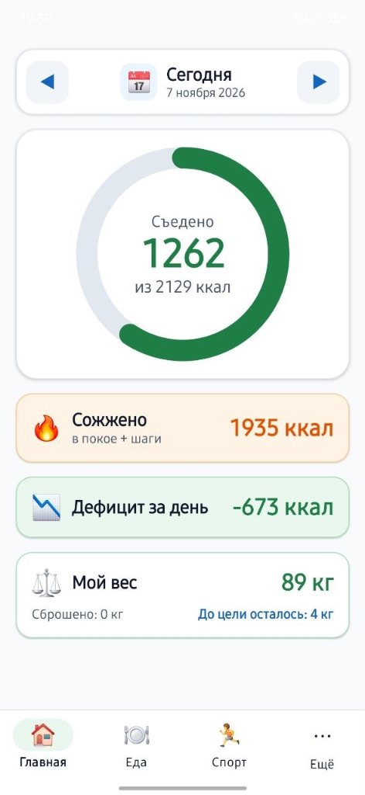
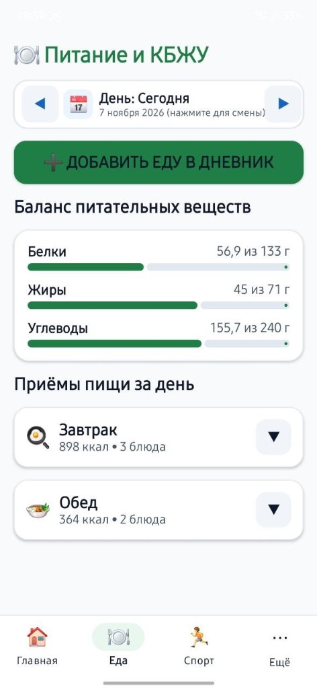
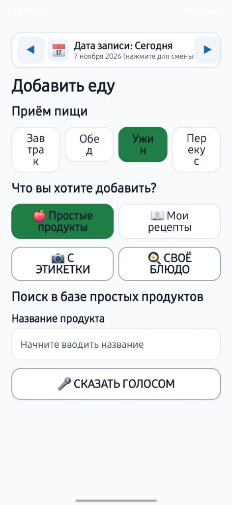
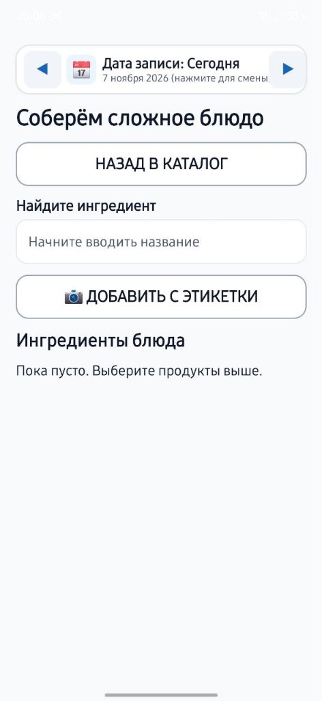
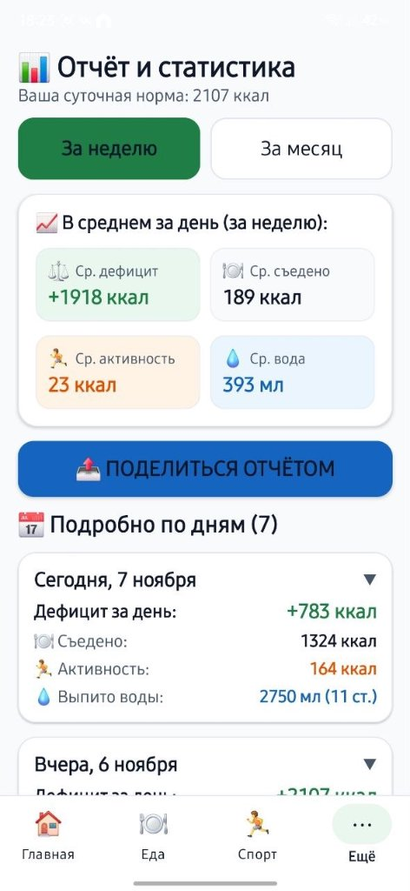
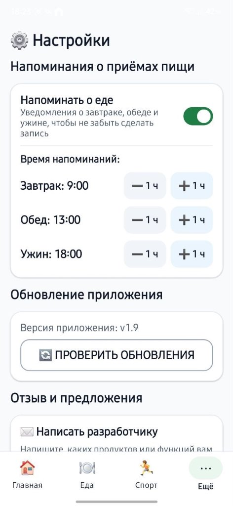

# Дневник питания и КБЖУ для пожилых людей (SeniorKbju)

[](https://github.com/kudrluba2003/kbju_dlya_pojulikh/actions/workflows/android.yml)
[](https://github.com/kudrluba2003/kbju_dlya_pojulikh/releases/latest)
[-blue)](https://developer.android.com)

Android-приложение подсчёта КБЖУ, активности, воды и динамики веса, специально спроектированное для людей старшего возраста:
* **Крупные элементы**: минимальный размер шрифта — 18–20sp, заголовки от 24sp до 34sp.
* **Цели нажатия от 56–72dp**: легко попадать даже при треморе рук или слабом зрении.
* **Высокий контраст**: сочные акцентные цвета, чёткий тёмный текст, отсутствие слепящих или блёклых элементов.
* **Понятный язык**: никаких сложных фитнес-терминов («Осталось съесть» вместо «Дефицит калорий», «Перебор» вместо «Профицит»).
* **Полный офлайн**: приложение полностью сохраняет функциональность без доступа к интернету.

---

## 📥 Скачать приложение

Готовый установочный файл APK доступен в разделе релизов:

👉 **[Скачать актуальный `app-release.apk` (v2.1)](https://github.com/kudrluba2003/kbju_dlya_pojulikh/releases/latest/download/app-release.apk)**

---

## 🌟 Ключевые возможности

1. **Главный экран (Bento-дашборд)**
   * Крупный кольцевой индикатор нормы калорий (формула Миффлина — Сан Жеора).
   * Растянутая плашка потраченных за день калорий с разбивкой по активностям.
   * Наглядная карточка суточного дефицита / профицита.
   * **Плашка «Мой вес»**: текущий вес, динамика от начала («Сброшено: X кг») и остаток до цели.
   * Все плашки на главной защищены от случайных нажатий (некликабельные).

2. **Дневник питания и аккордеон приёмов пищи**
   * Разворачивающиеся списки (завтрак, обед, ужин, перекусы) с крупными удобными стрелочками — нет длинных полотен на экране.
   * Возможность вести дневник **любой датой** (задним и передним числом) с помощью переключателя дней «◀ Дата ▶» и календаря.

3. **Офлайн-каталог продуктов (1 220+ позиций) и поиск в интернете**
   * Обширная встроенная база продуктов (1 220+ позиций) с точными КБЖУ, популярными брендами и готовыми блюдами.
   * **Умный поиск**: учитывает любые словоформы и вариативность порядка слов (например, находит и «Сок яблочный», и «Яблочный сок»).
   * **Подтяжка из интернета**: кнопка «Найти в интернете» (Open Food Facts) для добавления любых редких товаров в один клик.
   * Офлайн-распознавание таблиц пищевой ценности по фото упаковки (ML Kit Text Recognition) без отправки данных в сеть.
   * Конструктор своих сложных блюд с подсказками «Начните вводить название» во всех текстовых полях.

4. **Аналитика и отчёты за неделю / месяц**
   * Переключение периодов: **«За неделю»** (7 дней) и **«За месяц»** (30 дней).
   * Суммарная сводка ключевых средних показателей:
     * Средний дефицит (ккал/день)
     * Среднее потребление (съедено ккал/день)
     * Средняя активность (сожжено ккал/день)
     * Среднее количество воды (мл/день)
   * Разворачиваемый детальный просмотр каждого дня с возможностью поделиться текстовым отчётом с врачом или близкими.

5. **Учёт активности, воды и динамика веса**
   * Понятные пожилым людям активности: скандинавская ходьба, прогулка, работа на даче/огороде, домашняя уборка, зарядка.
   * Быстрый учёт воды гранёными стаканами по 250 мл.
   * Наглядный график веса за 30 дней на Canvas.

6. **Напоминания о приёмах пищи**
   * Фоновые уведомления (WorkManager) с возможностью тонкой настройки времени завтрака, обеда и ужина кнопками **«➖ 1 ч»** и **«➕ 1 ч»**.

7. **Безопасность, связь с разработчиком и управление данными**
   * Прямая и надёжная отправка отзывов разработчику Любови Кудрявцевой (`kudrluba2003@gmail.com`) в один клик с автокопированием текста.
   * Резервное копирование и восстановление всей базы данных в единый файл JSON.
   * Деликатная кнопка безопасного сброса истории дневника с подтверждением через диалог.
   * Встроенная форма обратной связи и отправки предложений разработчику.
   * Автоматическая проверка обновлений приложения прямо с GitHub Releases.

---

## 📱 Скриншоты

| Главный экран | Дневник питания (аккордеон) | Добавление еды / поиск |
|:---:|:---:|:---:|
|  |  |  |

| Конструктор сложных блюд | Отчёт за неделю и месяц | Настройки и напоминания |
|:---:|:---:|:---:|
|  |  |  |

---

## 🛠 Технологический стек

* **Язык**: Kotlin 2.0 (JVM target 17)
* **UI**: Jetpack Compose (Material 3), Canvas графика, адаптивная Bento-архитектура
* **Архитектура**: MVVM, Clean Architecture, StateFlow / Coroutines
* **База данных**: Room (схема 7 с полнотекстовыми индексами и миграциями), DataStore Preferences
* **Фоновые задачи**: AndroidX WorkManager (уведомления с точным временем)
* **Машинное зрение**: Google ML Kit Text Recognition (офлайн OCR этикеток)
* **Тестирование**: JUnit 4 (юнит-тесты формул КБЖУ, валидации, OCR-парсера)
* **CI/CD**: GitHub Actions (автоматическая сборка, тестирование, R8 оптимизация и публикация релизов с APK)

---

## 📂 Структура проекта

```
SeniorKbju/
├── .github/workflows/android.yml  # Автоматический CI/CD и релизы на GitHub
├── app/
│   ├── src/main/java/com/senior/kbju/
│   │   ├── KbjuApp.kt             # Application класс, инициализация базы и WorkManager
│   │   ├── MainActivity.kt        # Входная точка Activity
│   │   ├── data/
│   │   │   ├── backup/            # BackupManager (импорт/экспорт JSON)
│   │   │   ├── local/             # Room: AppDatabase (v7), Entity, DAO, миграции, SeedData и products_seed.json (1 220+ продуктов)
│   │   │   ├── model/             # Доменные модели (UserProfile, Enums)
│   │   │   ├── preferences/       # DataStore репозиторий
│   │   │   ├── remote/            # OpenFoodFactsClient (онлайн-подтяжка продуктов из сети)
│   │   │   └── repository/        # FoodRepository, DiaryRepository
│   │   ├── notification/          # WorkManager воркеры напоминаний о еде
│   │   ├── ui/
│   │   │   ├── components/        # Крупные UI-компоненты (BentoCard, BigButton, ModernCard, Canvas-графики)
│   │   │   ├── navigation/        # Навигационный граф (AppRoot, 4 основные вкладки)
│   │   │   ├── screens/           # Dashboard, Nutrition, Sports, MoreScreen, History, Water, Weight, Settings
│   │   │   └── theme/             # Доступная типографика и тема для пожилых
│   │   └── utils/
│   │       ├── AppUpdateChecker.kt   # Проверка обновлений через GitHub API и редиректы
│   │       ├── FeedbackSender.kt     # Сервис отправки отзывов
│   │       ├── NutritionMath.kt      # Расчёт калорийности и БЖУ (Миффлин — Сан Жеор)
│   │       ├── NutritionOcrParser.kt # Офлайн-парсер этикеток через ML Kit
│   │       └── RussianSearchUtils.kt # Умный поиск с учетом словоформ и порядка слов
│   └── src/test/                     # Unit-тесты
└── tools/
    ├── scrape_pbprog.py              # Скрипт парсинга базы продуктов
    └── build_catalog.py              # Генератор базы продуктов (1 220+ позиций)
```

---

## 🏗 Сборка из исходников

1. Клонируйте репозиторий:
   ```bash
   git clone https://github.com/kudrluba2003/kbju_dlya_pojulikh.git
   cd kbju_dlya_pojulikh
   ```
2. Откройте проект в **Android Studio** (Ladybug / Iguana или новее) с установленной **Java 17**.
3. Запустите тесты:
   ```bash
   ./gradlew testDebugUnitTest
   ```
4. Соберите релизный APK:
   ```bash
   ./gradlew assembleRelease
   ```
   Файл будет сохранён по пути: `app/build/outputs/apk/release/app-release.apk`.
