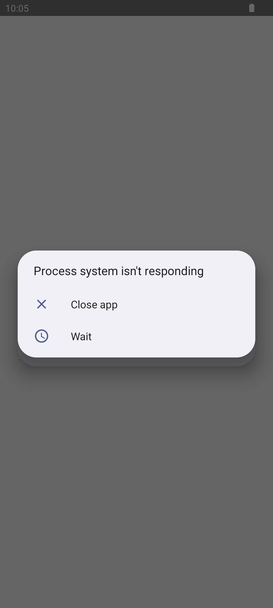
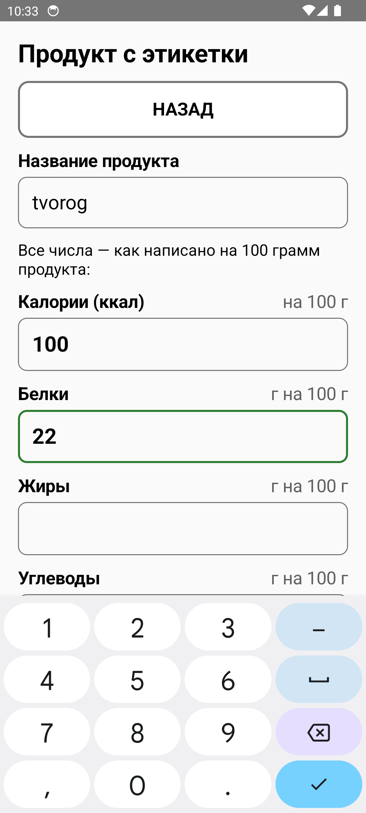
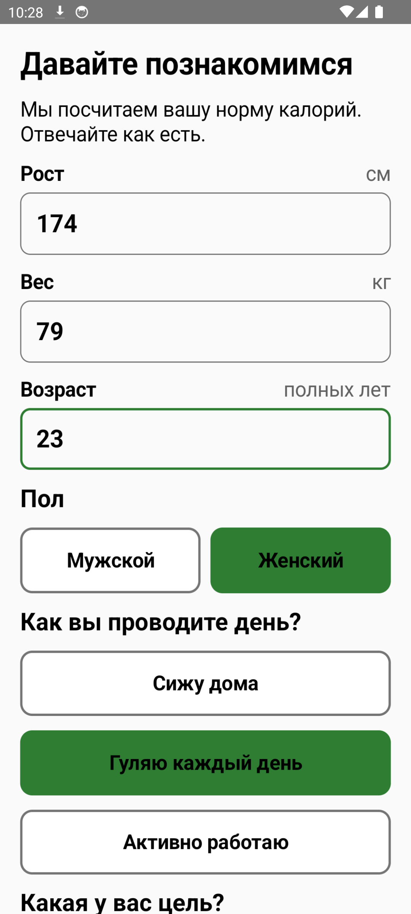

# Дневник питания и КБЖУ для пожилых людей (SeniorKbju)

[](https://github.com/kudrluba2003/kbju_dlya_pojulikh/actions/workflows/android.yml)
[](https://github.com/kudrluba2003/kbju_dlya_pojulikh/releases/latest)
[-blue)](https://developer.android.com)

Android-приложение подсчёта КБЖУ, активности, воды и динамики веса, специально спроектированное для людей старшего возраста:
* **Крупные элементы**: минимальный размер шрифта — 20sp, заголовки от 24sp до 34sp.
* **Цели нажатия от 72dp**: легко попадать даже при треморе рук или слабом зрении.
* **Высокий контраст**: сочные акцентные цвета и чёткий текст.
* **Понятный язык**: никаких непонятных терминов («Осталось съесть» вместо «Дефицит калорий», «Перебор» вместо «Профицит»).
* **Полный офлайн**: приложение работает без обязательного доступа к интернету.

---

## 📥 Скачать приложение

Готовый установочный файл APK доступен в разделе релизов:

👉 **[Скачать актуальный `app-release.apk`](https://github.com/kudrluba2003/kbju_dlya_pojulikh/releases/latest/download/app-release.apk)**

---

## 🌟 Ключевые возможности

1. **Умный расчёт нормы (Формула Миффлина — Сан Жеора)**
   * Учитывает возраст, рост, текущий вес, пол и уровень активности.
   * Безопасная граница калорийности (не опускается ниже 1200 ккал/день).
   * Автоматический пересчёт нормы при обновлении веса.
2. **Офлайн-сканирование этикеток (ML Kit Text Recognition)**
   * Сфотографируйте таблицу пищевой ценности на пачке продукта — приложение автоматически распознает калории, белки, жиры и углеводы прямо на устройстве без интернета.
3. **Офлайн-каталог продуктов и конструктор блюд**
   * Встроенная база продуктов и физических активностей.
   * Удобные бытовые меры: граммы, гранёный стакан (250 мл), столовая ложка.
   * Конструктор сложных блюд с автоматическим расчётом КБЖУ на 100 г готового блюда.
   * Быстрый доступ к частым активностям для пожилых людей (ходьба, скандинавская ходьба, огород/сад, уборка, гимнастика).
4. **Учёт воды и график веса**
   * Быстрая фиксация выпитой воды (стаканы по 250 мл).
   * График динамики веса за 30 дней, нарисованный на Jetpack Compose Canvas.
5. **Напоминания о приёмах пищи**
   * Мягкие ненавязчивые уведомления через WorkManager в завтрак, обед и ужин. Время регулируется.
6. **Экспорт отчёта для врача или родственников**
   * Формирование читаемого недельного отчёта по питанию и отправка через стандартное меню «Поделиться» (в Telegram, WhatsApp, SMS или на печать).
7. **Резервное копирование и перенос данных**
   * Экспорт всей базы в единый JSON-файл и восстановление в один клик при смене телефона.
8. **Автоматическая проверка обновлений**
   * Встроенный модуль проверки новых версий с GitHub Releases прямо из экрана профиля.
9. **Офлайн-логгер сбоев**
   * Локальное логирование ошибок в память устройства без сторонних внешних трекеров.

---

## 📱 Скриншоты

| Запуск и расчёт нормы | Главный экран (Дашборд) | Добавление еды / сканер |
|:---:|:---:|:---:|
|  |  |  |

---

## 🛠 Технологический стек

* **Язык**: Kotlin 2.0 (JVM target 17)
* **UI**: Jetpack Compose (Material 3), Canvas графика
* **Архитектура**: MVVM, Clean Architecture, Unidirectional Data Flow (StateFlow)
* **База данных**: Room (схема 7 с индексами поиска и миграциями), DataStore Preferences
* **Фоновые задачи**: AndroidX WorkManager
* **Машинное зрение**: Google ML Kit Text Recognition (офлайн OCR)
* **Тестирование**: JUnit 4 (24 unit-теста на математику, разбор ввода, регулярные выражения OCR, валидацию версий и миграции)
* **CI/CD**: GitHub Actions (автоматическое тестирование, компиляция release APK с R8 и публикация релизов)

---

## 📂 Структура проекта

```
SeniorKbju/
├── .github/workflows/android.yml  # Автоматический CI/CD и релизы на GitHub
├── app/
│   ├── src/main/java/com/senior/kbju/
│   │   ├── KbjuApp.kt             # Application класс, инициализация базы и WorkManager
│   │   ├── MainActivity.kt        # Входная точка Activity
│   │   ├── data/
│   │   │   ├── backup/            # BackupManager (импорт/экспорт JSON)
│   │   │   ├── local/             # Room: AppDatabase (v7), Entity, DAO, миграции
│   │   │   ├── model/             # Доменные модели (UserProfile, Enums)
│   │   │   ├── preferences/       # DataStore репозиторий
│   │   │   └── repository/        # FoodRepository, DiaryRepository
│   │   ├── notification/          # WorkManager воркеры напоминаний о еде
│   │   ├── ui/
│   │   │   ├── components/        # Крупные UI-компоненты, кольцевой прогресс, график веса
│   │   │   ├── navigation/        # Навигационный граф
│   │   │   ├── screens/           # Profile, Dashboard, AddFood, AddActivity, Weight, History
│   │   │   └── theme/             # Доступная типографика и тема
│   │   └── utils/
│   │       ├── AppUpdateChecker.kt   # Проверка обновлений через GitHub API
│   │       ├── CrashHandler.kt       # Офлайн-перехватчик падений
│   │       ├── NumberUtils.kt        # Защита от кривого ввода и парсинг чисел
│   │       ├── NutritionMath.kt      # Чистая математика калорийности и БЖУ
│   │       └── NutritionOcrParser.kt # Парсер таблиц КБЖУ с фото этикеток
│   └── src/test/                     # 24 Unit-теста
└── tools/
    └── scrape_pbprog.py              # Скрипт пополнения каталога продуктов
```

---

## 🏗 Сборка из исходников

1. Клонируйте репозиторий:
   ```bash
   git clone https://github.com/kudrluba2003/kbju_dlya_pojulikh.git
   cd kbju_dlya_pojulikh
   ```
2. Откройте проект в **Android Studio** (Ladybug / Iguana или новее) с установленной **Java 17**.
3. Запустите тесты:
   ```bash
   ./gradlew testDebugUnitTest
   ```
4. Соберите подписанный релизный APK:
   ```bash
   ./gradlew assembleRelease
   ```
   Файл будет сохранён по пути: `app/build/outputs/apk/release/app-release.apk`.
